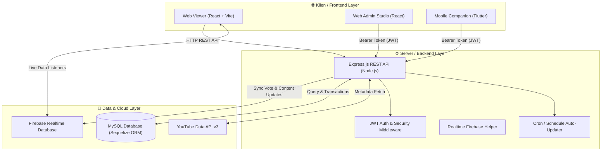

# X-VOCA Portal & Studio 🎙️✨

> **Official Fansite, Interactive Community Hub & Admin Management System**  
> Didedikasikan untuk Virtual Talent **Xion Regalia**. Dibangun dengan arsitektur Full-Stack modern yang menggabungkan web portal penonton, dashboard studio kreator, REST API berperforma tinggi, dan aplikasi mobile Flutter.

---

## 📌 Daftar Isi
- [Tentang Proyek](#-tentang-proyek)
- [Arsitektur Sistem](#-arsitektur-sistem)
- [Tech Stack](#-tech-stack)
- [Fitur Utama](#-fitur-utama)
  - [1. Portal Penonton (Public Viewer)](#1-portal-penonton-public-viewer)
  - [2. Studio Kreator & Admin (Private Dashboard)](#2-studio-kreator--admin-private-dashboard)
  - [3. Aplikasi Mobile (Flutter Admin Companion)](#3-aplikasi-mobile-flutter-admin-companion)
- [Struktur Repositori](#-struktur-repositori)
- [Instalasi & Panduan Menjalankan](#-instalasi--panduan-menjalankan)
  - [Prasyarat](#prasyarat)
  - [Langkah 1: Setup Backend](#langkah-1-setup-backend)
  - [Langkah 2: Setup Database & Migrasi](#langkah-2-setup-database--migrasi)
  - [Langkah 3: Setup Frontend](#langkah-3-setup-frontend)
  - [Langkah 4: Setup Mobile (Opsional)](#langkah-4-setup-mobile-opsional)
- [Daftar Endpoint API Utama](#-daftar-endpoint-api-utama)
- [Dokumentasi Tambahan](#-dokumentasi-tambahan)

---

## 📖 Tentang Proyek

**X-VOCA** adalah ekosistem digital komprehensif yang dirancang untuk mendukung operasional virtual streaming dan keterlibatan komunitas penggemar. Sistem ini memecahkan masalah fragmentasi informasi siaran dan interaksi penonton dengan menyediakan:
1. **Pusat Informasi Terpadu:** Jadwal siaran terkini, countdown dinamis, tautan streaming YouTube/Saweria, serta arsip rekaman video.
2. **Voting Game Interaktif & Adil:** Memberikan hak suara kepada penonton untuk menentukan game siaran berikutnya dengan perlindungan anti-spam berbasis *browser fingerprinting* tanpa mewajibkan penonton membuat akun (*frictionless*).
3. **Studio Manajemen Mandiri:** Dashboard terpusat bagi streamer/admin untuk mengelola jadwal siaran, moderasi usulan game, arsip konten, hingga kolaborasi sesama kreator.

---

## 🏛️ Arsitektur Sistem



---

## 🛠️ Tech Stack

### Web Frontend
* **Core:** React 18, Vite 6, React Router DOM v6
* **Styling:** Tailwind CSS (Cyberpunk Midnight Theme: `#0d0b1a`, `#141126`, `#7ee0d2`, `#c084fc`)
* **State & Networking:** Axios, React Context API, Firebase Web SDK
* **Icons & UI:** Lucide React, Canvas Confetti, HTML2Canvas, jsPDF
* **Fingerprinting:** `@fingerprintjs/fingerprintjs` (Zero-login fraud prevention)

### Web Backend
* **Runtime:** Node.js, Express.js
* **Database & ORM:** MySQL 8, Sequelize ORM
* **Realtime Sync:** Firebase Admin SDK (Realtime Database & FCM topic broadcasts)
* **Keamanan:** JWT (`jsonwebtoken`), `bcryptjs`, `cors`, `helmet`, rate limiting
* **Eksternal API:** Google YouTube Data API v3

### Mobile App
* **Framework:** Flutter 3 (Dart), Provider Pattern
* **Networking & Storage:** Dio / Http, Flutter Secure Storage
* **Components:** Custom theme matching web dark design tokens

---

## ✨ Fitur Utama

### 1. Portal Penonton (Public Viewer)
* **Hero Interactive Showcase:** Kartu profil interaktif Xion Regalia dengan selector mood/aura, visual Live Ready indicator, dan countdown waktu otomatis menuju siaran terdekat.
* **Jadwal Siaran & Countdown:** Kalender streaming mingguan dengan status dinamis (`scheduled`, `live`, `completed`), label kategori game, serta tombol langsung menuju stream YouTube.
* **Sistem Voting Game Komunitas:**
  * Penonton dapat memberikan suara untuk kandidat game bulan ini.
  * Dilengkapi fitur **Quick Vote (Top 3)** dan daftar lengkap dengan filter status (*Requested, Accepted, Playing, Done*).
  * Formulir **Request Game** publik bagi penonton untuk mengajukan usulan game baru.
  * **Anti-Spam Fingerprint:** Tiap browser hanya dapat memilih 1 kali per game dalam 1 periode bulan aktif tanpa perlu registrasi akun.
  * **Realtime Sync:** Perolehan suara ter-update secara otomatis tanpa reload halaman berkat integrasi Firebase Realtime Database.
* **Content Guide (Arsip Video):**
  * Katalog rekaman VOD siaran dengan filter kategori (*Elden Ring, Signalis, Zatsu, dll.*).
  * Video spotlight (*Featured Content*) dengan tombol putar dan salin tautan.
  * Strip statistik real-time (*Total Video, Kategori Aktif, Konten Baru*).
* **Collab Streamer Request Modal:** Penonton dapat merekomendasikan kreator/streamer lain untuk berkolaborasi bersama Xion Regalia.

### 2. Studio Kreator & Admin (Private Dashboard)
* **Keamanan Autentikasi:** Login administrator terlindungi token JWT dengan session timeout dan password hashing Bcrypt.
* **Dashboard Analitik:** Ringkasan statistik cepat, status siaran aktif, partisipasi suara periode berjalan, dan aktivitas terbaru.
* **Manajemen Jadwal Siaran (Schedule Manager):** Tambah, sunting, ubah status siaran, salin langsung ke Content Guide setelah siaran usai, serta sinkronisasi otomatis status jadwal.
* **Moderasi Usulan Game (Voting Moderation):**
  * Terima (*Accept*) usulan penonton agar masuk daftar voting publik.
  * Perbarui siklus hidup game: *Requested* ➔ *Accepted* ➔ *Playing* ➔ *Done*.
  * Reset periode voting bulanan (*Archive & New Period*).
  * Ekspor laporan rekapitulasi voting bulanan dalam format **PDF resmi**.
* **Manajemen Arsip Konten (Content Guide Manager):** Tambah arsip video baru, deteksi metadata YouTube otomatis, toggle visibilitas publik, serta penentuan *Featured Spotlight*.
* **Kotak Masuk Kolaborasi (Collab Inbox):** Review usulan kolaborasi komunitas beserta verifikasi tautan sosial media streamer.
* **To-Do List Internal:** Catatan kerja dan checklist prioritas streamer dalam studio.

### 3. Aplikasi Mobile (Flutter Admin Companion)
* Dashboard ringkas untuk memantau status sistem, jadwal, suara voting, dan to-do list langsung dari smartphone streamer/admin.

---

## 📂 Struktur Repositori

```text
x-voca/
├── docs/                             # Dokumentasi teknis, schema, PRD, dan panduan presentasi
│   ├── PANDUAN_PENJELASAN_KODE.md    # Panduan komprehensif bedah kode & persiapan tanya jawab
│   ├── ARCHITECTURE.md               # Arsitektur sistem detail
│   └── DATABASE_SCHEMA.md            # Desain relasi tabel MySQL
├── mobile/                           # Aplikasi Flutter Mobile Companion
│   ├── lib/
│   │   ├── core/                     # Theme, config, environment
│   │   ├── data/                     # Model & API services
│   │   └── presentation/             # Screens, widgets & providers
│   └── pubspec.yaml
├── web/
│   ├── backend/                      # Node.js + Express.js API
│   │   ├── config/                   # Konfigurasi database Sequelize & Firebase
│   │   ├── migrations/               # Database migrations
│   │   ├── seeders/                  # Initial demo seeders
│   │   ├── src/
│   │   │   ├── controllers/          # Business logic (schedule, game, vote, content, auth)
│   │   │   ├── middleware/           # Auth JWT & validation middleware
│   │   │   ├── models/               # Sequelize Data Models
│   │   │   ├── routes/               # API route definitions
│   │   │   └── utils/                # Firebase helper, YouTube client, logger
│   │   ├── .env                      # Environment variables backend
│   │   └── server.js                 # Entrypoint server Express
│   └── frontend/                     # React + Vite Client
│       ├── src/
│       │   ├── assets/               # Gambar, logo, ikon statis
│       │   ├── components/           # Reusable components (admin, viewer, common)
│       │   ├── context/              # AuthContext, NotificationContext
│       │   ├── hooks/                # useFirebase, useToast
│       │   ├── pages/
│       │   │   ├── admin/            # Dashboard, Schedule, Voting Moderation, Content
│       │   │   └── viewer/           # HomePage, VotingPage, ContentGuidePage
│       │   ├── services/             # Axios API service wrappers
│       │   └── utils/                # Fingerprint helper, date formatter, PDF export
│       ├── .env                      # Environment variables frontend
│       ├── tailwind.config.js        # Konfigurasi Tailwind & palet warna
│       └── vite.config.js            # Konfigurasi Vite bundler
└── README.md                         # Dokumentasi utama proyek
```

---

## 🚀 Instalasi & Panduan Menjalankan

### Prasyarat
* **Node.js:** Versi 18.x atau lebih baru
* **npm:** Versi 9.x atau lebih baru
* **MySQL:** MySQL Server 8.0+ atau MariaDB (via XAMPP / Laragon / Native)
* **Flutter SDK:** (Hanya jika ingin menjalankan aplikasi mobile)

---

### Langkah 1: Setup Backend
1. Masuk ke direktori backend:
   ```bash
   cd web/backend
   npm install
   ```
2. Buat file `.env` di folder `web/backend` (atau gunakan file yang ada):
   ```env
   PORT=3001
   NODE_ENV=development
   DB_HOST=127.0.0.1
   DB_PORT=3306
   DB_NAME=xvoca_db
   DB_USER=root
   DB_PASS=
   JWT_SECRET=xvoca_super_secret_jwt_key_2026
   FIREBASE_DATABASE_URL=https://xvoca-project.firebaseio.com
   FIREBASE_SERVICE_ACCOUNT_PATH=./firebase-service-account.json
   YOUTUBE_API_KEY=your_youtube_api_key_here
   CORS_ORIGIN=http://localhost:5173
   ```

---

### Langkah 2: Setup Database & Migrasi
1. Pastikan server MySQL sudah berjalan di komputer Anda.
2. Buat database kosong bernama `xvoca_db`:
   ```sql
   CREATE DATABASE xvoca_db CHARACTER SET utf8mb4 COLLATE utf8mb4_unicode_ci;
   ```
3. Jalankan migrasi dan seeder data awal:
   ```bash
   cd web/backend
   npx sequelize-cli db:migrate
   npx sequelize-cli db:seed:all
   ```
4. Jalankan backend server:
   ```bash
   npm run dev
   # Server berjalan di http://localhost:3001
   ```

---

### Langkah 3: Setup Frontend
1. Buka terminal baru dan masuk ke direktori frontend:
   ```bash
   cd web/frontend
   npm install
   ```
2. Buat file `.env` di folder `web/frontend`:
   ```env
   VITE_API_URL=http://localhost:3001
   VITE_FIREBASE_API_KEY=your_firebase_api_key
   VITE_FIREBASE_AUTH_DOMAIN=xvoca-project.firebaseapp.com
   VITE_FIREBASE_DATABASE_URL=https://xvoca-project.firebaseio.com
   VITE_FIREBASE_PROJECT_ID=xvoca-project
   VITE_FIREBASE_STORAGE_BUCKET=xvoca-project.appspot.com
   VITE_FIREBASE_MESSAGING_SENDER_ID=123456789
   VITE_FIREBASE_APP_ID=1:123456789:web:abcdef
   ```
3. Jalankan development server:
   ```bash
   npm run dev
   # Frontend berjalan di http://localhost:5173
   ```
4. Akses aplikasi melalui browser:
   * **Portal Penggemar (Viewer):** `http://localhost:5173`
   * **Halaman Voting Publik:** `http://localhost:5173/voting`
   * **Arsip Konten:** `http://localhost:5173/content-guide`
   * **Login Admin Studio:** `http://localhost:5173/login` *(Default akun ada di database seeder)*

---

### Langkah 4: Setup Mobile (Opsional)
```bash
cd mobile
flutter pub get
flutter run
```

---

## 📡 Daftar Endpoint API Utama

| Modul | Method | Endpoint | Akses | Keterangan |
| :--- | :---: | :--- | :---: | :--- |
| **Auth** | `POST` | `/api/auth/login` | Publik | Autentikasi admin, mengembalikan token JWT |
| | `GET` | `/api/auth/me` | Admin | Memverifikasi sesi login token aktif |
| **Schedule** | `GET` | `/api/schedules` | Publik | Mengambil daftar jadwal siaran |
| | `GET` | `/api/schedules/next` | Publik | Mengambil 1 jadwal siaran terdekat berikutnya |
| | `POST` | `/api/schedules` | Admin | Membuat jadwal siaran baru |
| | `PATCH` | `/api/schedules/:id/status` | Admin | Memperbarui status siaran (`live`, `completed`) |
| **Games & Vote** | `GET` | `/api/games` | Publik | Mengambil daftar kandidat game & persentase suara |
| | `POST` | `/api/votes/:gameId` | Publik | Mengirim vote (validasi fingerprint browser) |
| | `POST` | `/api/votes/request` | Publik | Mengirim usulan game baru dari penonton |
| | `PATCH` | `/api/games/:id/status` | Admin | Memperbarui status game (*accepted/playing/done*) |
| | `POST` | `/api/votes/reset-period` | Admin | Reset voting dan arsipkan periode bulanan |
| **Content** | `GET` | `/api/content` | Publik | Mengambil arsip rekaman video |
| | `GET` | `/api/content/stats` | Publik | Mengambil statistik real-time (*Total Video, Kategori*) |
| | `POST` | `/api/content` | Admin | Menambahkan arsip siaran baru |
| **Collab** | `POST` | `/api/collab-requests` | Publik | Mengirim saran kreator untuk kolaborasi |
| | `GET` | `/api/collab-requests` | Admin | Moderasi daftar usulan kolaborasi komunitas |

---

## 📚 Dokumentasi Tambahan

Untuk persiapan menghadapi **sidang skripsi, ujian tugas akhir, review klien, atau presentasi teknis**, silakan pelajari dokumen khusus berikut:
* 📘 [**Panduan Penjelasan Kode & Tanya Jawab Teknis**](file:///d:/CODING/Project%20FullStack/x-voca/docs/PANDUAN_PENJELASAN_KODE.md): Bedah tuntas setiap baris kode penting, logika bisnis krusial, cara kerja algoritma anti-spam, hingga simulasi pertanyaan penguji beserta jawaban siap pakainya.

---

**X-VOCA Ecosystem** — Built with clean code, zero AI slop, and tailored for virtual streaming communities.
